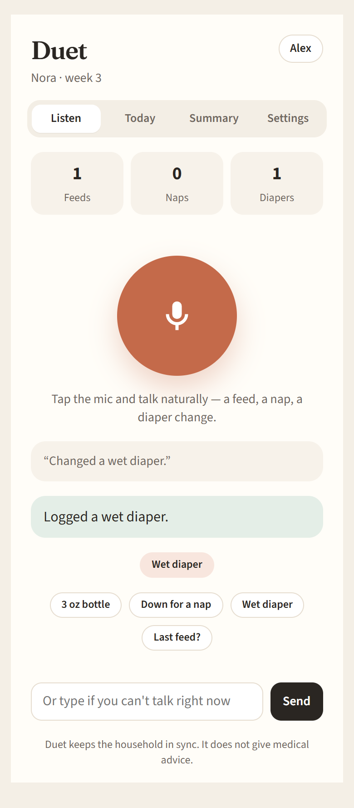
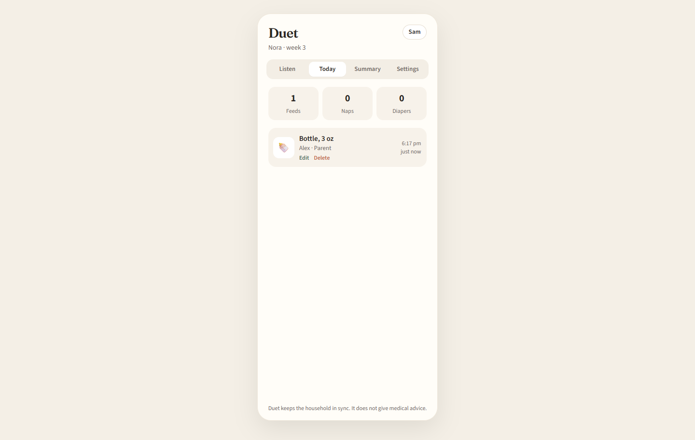
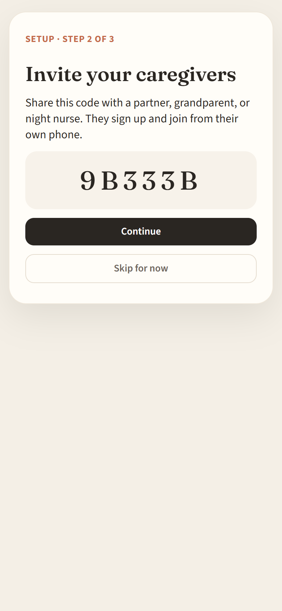
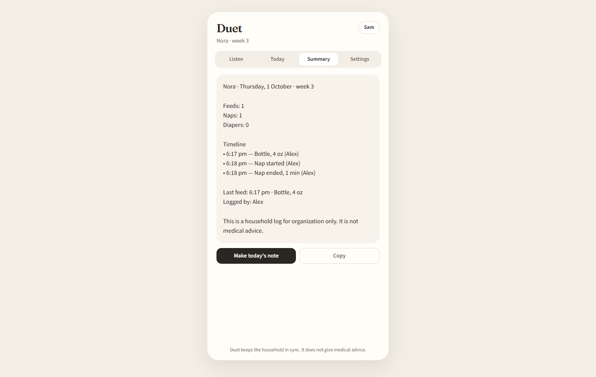

# Duet — Test Report

**Project:** Duet, a voice-first baby log shared by everyone caring for a newborn\
**Test date:** October 1, 2026 (final run 6:17–6:18 PM)\
**Result:** 115 of 115 checks passed. Testing found 4 real bugs; all are fixed and covered by tests.

---

## 1. Summary

| Test suite | Command | What it checks | Passed |
|---|---|---|---|
| Unit tests | `npm test` | How Duet understands typed or spoken sentences | 11 / 11 |
| End-to-end tests | `npm run test:e2e` | Every server feature with two caregivers and an outsider, live sync, the installable-app files, and the Android project setup | 73 / 73 |
| Browser tests | `npm run test:ui` | The real app in Microsoft Edge, with one caregiver on a phone-sized screen and one on a desktop screen at the same time | 31 / 31 |
| **Total** | | | **115 / 115** |

Raw output from the final run is saved next to this report:
`unit-test-output.txt`, `e2e-test-output.txt`, `ui-test-output.txt`.

---

## 2. Test environment

| Item | Value |
|---|---|
| Computer | Windows 11 |
| Runtime | Node.js 24.16 |
| Server | Duet production build on `http://127.0.0.1:5000` |
| Database | SQLite (fresh test accounts are created for every run) |
| Browser | Microsoft Edge (automated, headless) |
| Screen sizes | Phone 390×844, tablet 768×1024, desktop 1440×900 |
| Speech parsing | Built-in local parser (no paid AI key needed) |

---

## 3. How the testing was done

Testing happens in three layers, from smallest to largest:

1. **Unit tests** check the sentence parser alone. This is the part that turns "Just gave her a 3 ounce bottle" into a logged feed of 90 ml.
2. **End-to-end tests** act like two real caregivers, Alex and Sam, plus an outsider who should be locked out. They go through the whole server: sign up, create and join a household, log entries, edit, delete, live sync, settings and export. The same suite also checks the installable-app files and the Android project.
3. **Browser tests** open the real app in Edge and click through it like a person would. Alex uses a phone-sized window and Sam a desktop window, at the same time, so you can watch one person's entry appear live on the other's screen.

Real speech can't be automated. For the voice test, a stand-in speech recognizer "hears" a fixed sentence. That checks everything after the speech step: the mic button, the transcript, logging, and live sync.

---

## 4. Unit tests: 11 / 11 passed

| # | Test | Result |
|---|---|---|
| 1 | Logs a bottle feed and converts ounces to ml | Pass |
| 2 | Starts a nap | Pass |
| 3 | Ends an open nap and works out how long it lasted | Pass |
| 4 | Logs a wet diaper | Pass |
| 5 | Answers "When did she last eat?" from today's log | Pass |
| 6 | Refuses medical advice (e.g. "should I give Tylenol?") | Pass |
| 7 | Doesn't log gibberish | Pass |
| 8 | Ignores filler words in messy voice transcripts ("um, like…") | Pass |
| 9 | Logs a feed from "she had 4 ounces" without the word "bottle" *(added after bug #2)* | Pass |
| 10 | Logs a feed from "she drank 90 milliliters" *(added after bug #2)* | Pass |
| 11 | Says "1 minute", not "1 minutes" | Pass |

---

## 5. End-to-end tests: 73 / 73 passed

### Server (1)
| Test | Result |
|---|---|
| Health check responds and confirms the app is free | Pass |

### Accounts (10)
| Test | Result |
|---|---|
| Signup rejects missing fields | Pass |
| Signup rejects a password shorter than 8 characters | Pass |
| Caregiver A can sign up | Pass |
| The same email can't sign up twice | Pass |
| Login works regardless of email capitalization | Pass |
| Wrong password is rejected | Pass |
| Account info requires being signed in | Pass |
| A fake login token is rejected | Pass |
| Account info returns the right person | Pass |
| Caregiver B and an outsider can sign up | Pass |

### Household and invites (9)
| Test | Result |
|---|---|
| Creating a household requires the baby's name and birth date | Pass |
| Caregiver A creates a household and gets an invite code | Pass |
| Household data requires choosing a household | Pass |
| An outsider can't read the household | Pass |
| An outsider can't open the live-update connection | Pass |
| A wrong invite code is rejected | Pass |
| A sees a live update the moment B joins with the invite code | Pass |
| Both caregivers appear in the household | Pass |
| B's app loads the household correctly | Pass |

### Logging: voice transcripts and typed text (13)
| Test | Result |
|---|---|
| B's live-update connection opens | Pass |
| A logs a bottle from a clean voice transcript | Pass |
| B receives A's entry live, without refreshing | Pass |
| A messy voice transcript with filler words still logs *(failed before bug #2 fix)* | Pass |
| Typed text logs a wet diaper | Pass |
| Starting a nap shows the nap timer for both caregivers | Pass |
| The wake button ends the nap | Pass |
| Pressing wake with no nap running gives a friendly message | Pass |
| "When did she last eat?" answers without logging anything | Pass |
| Medical question is refused and nothing is logged | Pass |
| Gibberish isn't logged | Pass |
| An empty transcript gives a friendly message | Pass |
| Daily counts are correct (2 feeds, 1 nap, 1 diaper) | Pass |

### Edit and delete (6)
| Test | Result |
|---|---|
| A edits the bottle's amount and adds a note | Pass |
| B sees the edit live | Pass |
| Editing an entry that doesn't exist returns "not found" | Pass |
| An outsider can't edit the entry | Pass |
| B deletes the entry; it disappears for A and the counts go down | Pass |
| Deleting the same entry twice returns "not found" | Pass |

### Summary, settings and export (12)
| Test | Result |
|---|---|
| The daily summary lists the right counts | Pass |
| The owner renames the baby and B sees it live | Pass |
| A non-owner can't change the invite code | Pass |
| The owner changes the invite code and the old one stops working | Pass |
| A caregiver can change their display name | Pass |
| The export includes the household, caregivers, entries and messages | Pass |
| A non-owner can't delete the household | Pass |
| The owner can't remove themselves *(added after bug #1)* | Pass |
| The owner removes B, who has logged entries, and B loses access *(failed before bug #1 fix)* | Pass |
| B's past entries stay in the log after removal *(added after bug #1)* | Pass |
| B can rejoin with the current invite code *(added after bug #1)* | Pass |
| The owner deletes the household (cleanup) | Pass |

### Android app can reach the server (3)
| Test | Result |
|---|---|
| Server accepts requests from the Android app's address `https://localhost` | Pass |
| Server accepts requests from `capacitor://localhost` | Pass |
| Server accepts requests from `http://localhost` | Pass |

### Installable web app (11)
| Test | Result |
|---|---|
| The page has the manifest link and the iPhone install tags | Pass |
| The manifest has every required field, including "standalone" display | Pass |
| The manifest includes 192px, 512px and maskable icons | Pass |
| Every icon loads and is exactly the size it claims to be | Pass |
| The iPhone home-screen icon is 180×180 | Pass |
| The browser-tab icon loads | Pass |
| The service worker stores the app shell for offline use | Pass |
| Every file the service worker stores actually exists | Pass |
| Live data (the API) is never served from the offline cache | Pass |
| Unknown links open the app instead of a blank 404 page | Pass |
| The page background is warm linen before the app loads (no white flash) | Pass |

### Android project setup (8)
| Test | Result |
|---|---|
| App ID `com.duet.household`, name "Duet", built from the same web code | Pass |
| The Android app ID and label are correct | Pass |
| Internet and microphone permissions are set; plain HTTP to the computer is allowed | Pass |
| The native speech-recognition plugin is registered | Pass |
| Launcher icons and splash screens exist for every screen density | Pass |
| The launcher icon is the Duet icon, not the Capacitor default | Pass |
| The Android copy of the web app matches the latest build | Pass |
| The Android app points at `10.0.2.2:5000` (the emulator's address for your computer) | Pass |

---

## 6. Browser tests: 31 / 31 passed

### Landing page and layout (6)
| Test | Result |
|---|---|
| Landing page fits a phone screen without sideways scrolling | Pass |
| Every main button has a visible white label on phone *(added after bug #4)* | Pass |
| Landing page fits a desktop screen without sideways scrolling | Pass |
| Every main button has a visible white label on desktop *(added after bug #4)* | Pass |
| Landing page fits a tablet screen | Pass |
| Edge reports the site as installable with no manifest errors | Pass |

### Signup and household, Alex on a phone (3)
| Test | Result |
|---|---|
| Alex signs up through the form | Pass |
| Alex creates a household and gets an invite code | Pass |
| Alex logs the first entry by typing during setup | Pass |

### Sam joins on a desktop (2)
| Test | Result |
|---|---|
| Sam signs up and joins with the invite code | Pass |
| Sam sees Alex's first entry on the Today screen | Pass |

### Voice and text logging with live sync (7)
| Test | Result |
|---|---|
| Alex logs by voice: mic button, then transcript, then logged | Pass |
| Sam sees the voice entry live, without refreshing | Pass |
| Alex logs by typing and the nap timer appears | Pass |
| Sam sees the nap live | Pass |
| "She woke up" button ends the nap | Pass |
| The "Last feed?" quick button answers | Pass |
| A medical question gets a polite refusal | Pass |

### Edit and delete with live sync (3)
| Test | Result |
|---|---|
| Sam edits the bottle's amount and adds a note | Pass |
| Alex sees the edit live | Pass |
| Sam deletes the diaper entry and it disappears for Alex | Pass |

### Summary and settings screens (4)
| Test | Result |
|---|---|
| Summary works and fits on phone | Pass |
| Settings screen fits on phone | Pass |
| Summary works and fits on desktop | Pass |
| Settings screen fits on desktop | Pass |

### Offline: how the installed app behaves (4)
| Test | Result |
|---|---|
| The service worker takes control of the page | Pass |
| An entry typed while offline is saved to send later | Pass |
| Reopening the app offline shows a clear message (not a blank screen) and stays signed in *(failed before bug #3 fix)* | Pass |
| Back online, the app reloads itself and the saved entry reaches Sam | Pass |

### Session (2)
| Test | Result |
|---|---|
| Staying signed in survives a normal page reload | Pass |
| No JavaScript errors during the whole run | Pass |

---

## 7. Bugs found by testing (all fixed)

| # | Bug | How it was found | Fix |
|---|---|---|---|
| 1 | **Removing a caregiver crashed the server.** It failed for anyone who had ever logged an entry, because the database wouldn't delete a caregiver who still had entries. | End-to-end test: "Owner removes B" got a server error | Removal now takes away the caregiver's access but keeps their past entries. They can rejoin with an invite code, and the owner can't remove themselves. |
| 2 | **"She just had 4 ounces" wasn't logged.** The parser recognized "ounce" but not "ounces", and missed "drank". This matters most for natural speech. | End-to-end test: messy voice transcript came back as "unclear" | Added "ounces", "drank" and "milliliters" to the feed words, with 2 new unit tests. |
| 3 | **Opening the installed app offline signed the user out.** The failed account check erased the saved login. | Code review while writing the offline browser test | The app now keeps you signed in offline, shows "You're offline…", and reloads by itself when the connection returns. |
| 4 | **The header button on the landing page had no visible label.** It showed as a blank black bar because a header style made its text dark on a dark background. | Looking over the browser-test screenshots | Fixed the text color and shortened the label to "Get started". A new check makes sure every main button has a visible white label. |

---

## 8. What was not tested, and why

| Not tested | Why | How to check it yourself |
|---|---|---|
| Running inside the Android emulator | Android Studio isn't installed on the test computer | Install Android Studio, run `npm start`, `npm run cap:sync`, `npm run cap:open`, then press Run. Speak into the mic once. |
| Real spoken voice | Automated tests can't use a microphone; a stand-in recognizer was used | Open the site in Chrome, tap the mic and say "Just gave her a 3 ounce bottle." |
| iPhone Safari "Add to Home Screen" | No iPhone or Mac was available | On an iPhone: open the site in Safari, tap Share, then "Add to Home Screen". |

---

## 9. How to run the tests again

With the server running (`npm start`) in one terminal, run these in another:

```bash
npm test          # 11 unit tests
npm run test:e2e  # 73 end-to-end tests
npm run test:ui   # 31 browser tests (screenshots saved to test-results/)
```

Each one should end with `0 failed`.

---

## 10. Screenshots from the browser tests

| Phone: voice entry logged | Desktop: live Today timeline |
|---|---|
|  |  |

| Phone: invite code | Desktop: daily summary | Phone: offline screen |
|---|---|---|
|  |  |  |

All screenshots are in `docs/screenshots/`.
